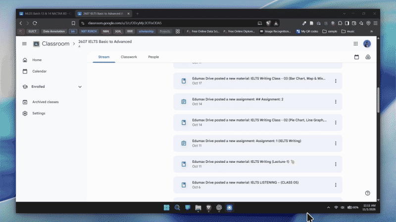

# EkClick — Google Classroom Downloads

EkClick is a browser extension that helps you find and download attachments from Google Classroom. It supports individual post pages and inline attachments in course Stream announcements. Choose an announcement to see only its files.

## Features

- Discover Drive attachments on Classroom post, material, assignment, and Stream pages.
- Select an announcement before viewing or downloading its Stream attachments.
- Review, select, and rename files before adding them to the download queue.
- Download to the browser's default location or to a folder you select for EkClick.
- Organize files with course and post folder names; create a ZIP from selected files in the chosen EkClick folder.
- Track progress, retry failed downloads, and clear EkClick's local download history.
- Keep settings and queue data in local browser storage. EkClick does not upload files or account information to a server.

## Walkthrough



The animated preview loops automatically. [Open the full walkthrough video (MP4)](media/EkClick-Walkthrough.mp4) for the original video and audio.

## Install from source

1. Download or clone this repository.
2. Open `brave://extensions` in Brave or `chrome://extensions` in Chrome.
3. Turn on **Developer mode**.
4. Select **Load unpacked** and choose the [`Source Code`](Source%20Code/) directory.
5. Open Google Classroom while signed in, then select EkClick from the browser toolbar.

The extension has no build step. After pulling updates, use **Reload** on the extension's card and refresh the Classroom tab.

## Use

On a post/details page, open EkClick and select the attachments you want. On a course Stream page, refresh EkClick after the posts appear, choose an announcement from the dropdown, then select its attachments. Scroll the Stream to load more announcements and press **Refresh** to discover them.

Choose the destination in Settings:

- **Default browser location** uses the browser's configured Downloads folder and save-dialog preference.
- **Selected EkClick folder** writes files to the folder you select. The browser may ask you to grant or renew folder access.

ZIP downloads are available with **Selected EkClick folder**. Files that require access from a signed-in Google account can only be downloaded if that account is permitted to access them. EkClick does not bypass Classroom or Drive sharing permissions.

See [`Source Code/README.md`](Source%20Code/README.md) for detailed behavior, permissions, privacy notes, and troubleshooting.

## Development and tests

Requires Node.js 18 or later. From the extension directory:

```sh
cd "Source Code"
npm test
npm run check
```

The automated tests cover attachment discovery, multiple Stream announcements, lazy-loaded posts, download validation and queue behavior, folder permissions, and ZIP creation. They do not use a signed-in Google account; verify live Classroom and Drive behavior in your browser.

## Repository layout

- `Source Code/` — installable extension, tests, and technical documentation.
- `EkClick_UI_Reference/` — offline UI prototype and design notes.
- `Logo/` — project logo source notes.

## Privacy and permissions

EkClick reads attachment links and labels from the active Google Classroom page. Drive host access is optional and requested when selected-folder downloads need to fetch file contents. Settings and download history stay in local extension storage. The extension does not add OAuth scopes, upload files, or send Classroom data to an external service. Downloads remain subject to Google's access controls and your signed-in account's permissions.

## License

No license has been added yet. Until a license is included, the source remains subject to the repository owner's rights.
