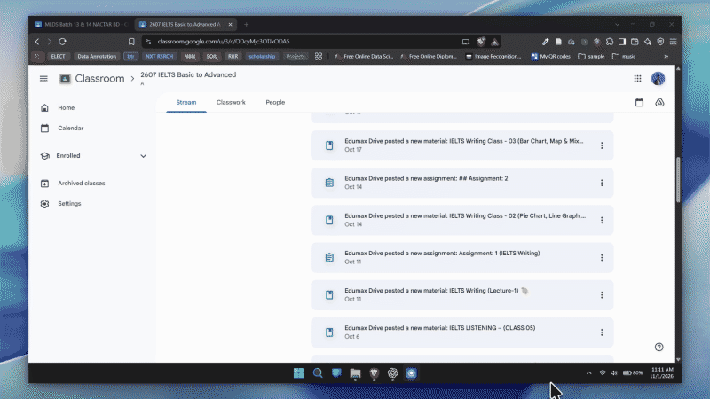
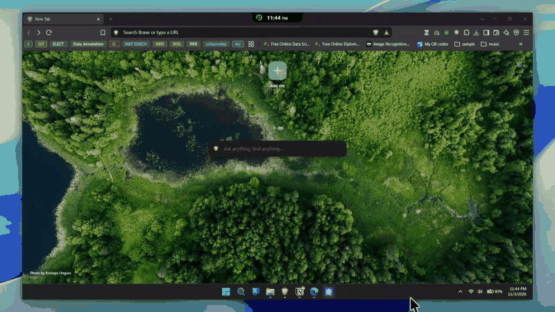

<p align="center">
  
</p>

<h1 align="center">Download your Classroom attachments with ease</h1>

<p align="center">
  EkClick finds attachments in Google Classroom and helps you save them, individually or as a ZIP.
</p>

<p align="center">
  <a href="#features">Features</a> ·
  <a href="#walkthrough">Walkthrough</a> ·
  <a href="#manual-installation">Install</a> ·
  <a href="#using-ekclick">How to use</a> ·
  <a href="#privacy">Privacy</a>
</p>

> **Not on the Chrome Web Store yet.** Install EkClick manually from this repository using the steps below.

## Features

- Find Drive attachments on Classroom posts, materials, assignments, and course Stream announcements.
- Choose a Stream announcement to see only the files attached to that post.
- Review, select, and rename files before downloading.
- Save to your browser's default download location or a folder you choose for EkClick.
- Organize downloads by course and post, and create ZIP archives in your selected EkClick folder.
- Track progress, retry failed downloads, and clear EkClick's local download history.
- Keep settings and download history in local browser storage. EkClick does not upload files or account information to a server.

## Walkthrough

See EkClick's features in action:



The preview loops automatically. [Watch the full walkthrough with audio](media/EkClick-Walkthrough.mp4).

## Manual installation

Follow the video, or use the steps below. EkClick has no build step.



1. On the [EkClick GitHub repository](https://github.com/Arnabtheaich/Ek-Click), select **Code** → **Download ZIP**. Extract the downloaded ZIP file. You can also clone the repository with Git.
2. Open `brave://extensions` in Brave or `chrome://extensions` in Chrome.
3. Turn on **Developer mode**.
4. Select **Load unpacked** and choose the extracted `Source Code` folder.
5. Open Google Classroom while signed in, then select EkClick from the browser toolbar.

After downloading an update, extract it and use **Reload** on EkClick's extension card. Refresh the Classroom tab afterward. [Open the installation video with audio](media/manual%20installation.mp4).

## Using EkClick

### Find attachments

- **Post, material, or assignment:** Open its details page, then open EkClick.
- **Course Stream:** Open EkClick after announcements load, choose an announcement, and select its attachments. Scroll the Stream to load more posts, then press **Refresh** to find them.

### Choose where files are saved

| Destination | What it does |
| --- | --- |
| **Default browser location** | Saves through the browser to its configured Downloads location and follows its save-dialog setting. |
| **Selected EkClick folder** | Writes files directly to the folder you select. The browser may ask you to grant or renew folder access. ZIP downloads are available in this mode. |

Downloads still follow Google's sharing permissions. EkClick can download a file only when the signed-in Google account has access to it.

For detailed behavior, permissions, and troubleshooting, see [`Source Code/README.md`](Source%20Code/README.md).

## Development

Requires Node.js 18 or later. Run these commands from the extension folder:

```sh
cd "Source Code"
npm test
npm run check
```

Tests cover attachment discovery, multiple Stream announcements, lazy-loaded posts, download validation and queue behavior, folder permissions, and ZIP creation. They do not use a signed-in Google account, so verify live Classroom and Drive behavior in your browser.

## Repository contents

| Folder | Contents |
| --- | --- |
| [`Source Code/`](Source%20Code/) | Installable extension, tests, and technical documentation |
| [`EkClick_UI_Reference/`](EkClick_UI_Reference/) | Offline UI prototype and design notes |
| [`Logo/`](Logo/) | SVG logo and icon assets, plus original logo notes |
| [`media/`](media/) | Walkthrough videos and README previews |

## Privacy

EkClick reads attachment links and labels from the active Google Classroom page. Drive host access is optional and requested when selected-folder downloads need to fetch file contents. Settings and download history stay in local extension storage. EkClick does not add OAuth scopes, upload files, or send Classroom data to an external service. Downloads remain subject to Google's access controls and your account's permissions.

## License

No license has been added yet. Until one is included, the source remains subject to the repository owner's rights.
